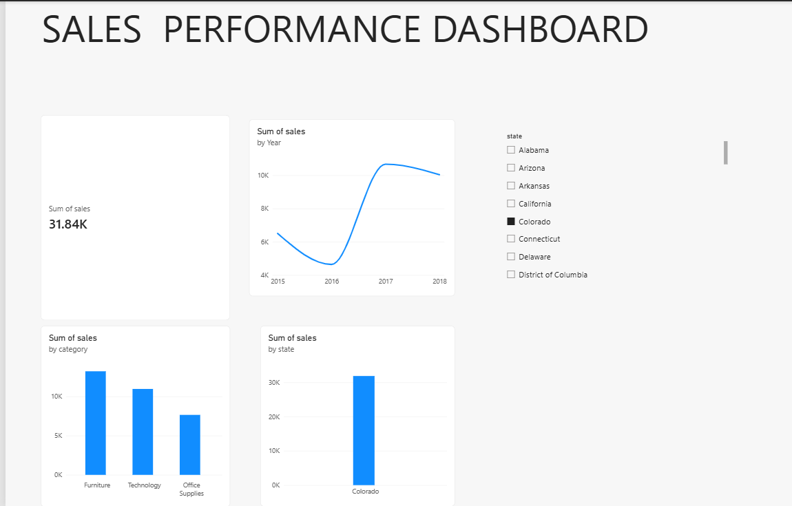

# Sales Performance & Business Intelligence Dashboard

## 📌 Project Overview
Developed an end-to-end data analytics pipeline to analyze retail sales data. This project extracts raw transactional data, cleans and transforms it using Python, loads it into a SQL database for querying, and visualizes the insights in an interactive Power BI dashboard.

## 🛠️ Technologies Used
* **Python** (Pandas) - Data cleaning and transformation
* **SQL** (SQLite) - Database creation and querying
* **Power BI** - Interactive data visualization
* **Microsoft Excel** - Data exploration

## ⚙️ The ETL Pipeline
1. **Extract:** Loaded raw retail data (10,000+ records) from a CSV file.
2. **Transform:** 
   * Cleaned column names (lowercased, removed spaces).
   * Handled international date formats (Day/Month/Year) to ensure proper time-series analysis.
   * Removed duplicate records.
3. **Load:** Exported the clean data and loaded it into a SQLite database for fast querying.

## 📊 SQL Analysis
Wrote SQL queries to aggregate business metrics, including:
* Total revenue by state (`GROUP BY`, `SUM`).
* Top 10 customers by revenue.
* Monthly sales trends using date functions (`STRFTIME`).

## 📈 Power BI Dashboard
Built an interactive dashboard featuring:
* **KPI Cards:** Total Revenue.
* **Line Chart:** Sales trend over time (2015–2018).
* **Bar Charts:** Sales by State and Sales by Category.
* **Slicer:** Dynamic filtering by state to allow stakeholders to drill down into specific markets.

## 💡 Key Insights
*   **Revenue Growth:** The company saw a massive surge in sales starting in 2017, doubling its revenue trajectory by 2018.
*   **State Dominance:** California is the top-performing market, generating the highest total revenue compared to other states.
*   **Product Performance:** Furniture and Technology are the highest-grossing product categories.
